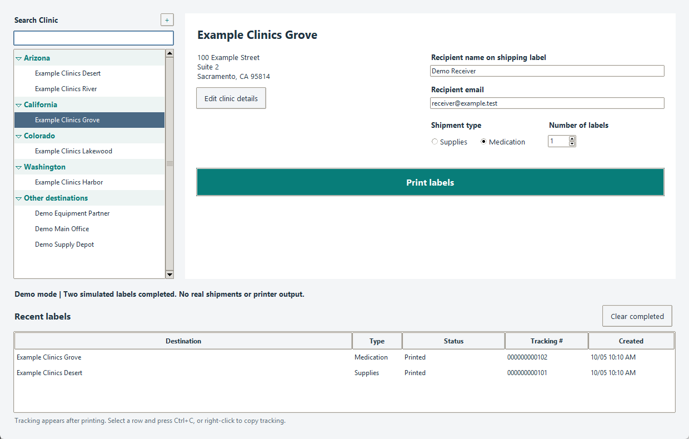

# Clinic Shipping Automation

**Prepare the next shipment while the current label prints.**

A Windows desktop application that turns repetitive FedEx label preparation into a searchable clinic directory, a serial print queue, and automatic post-print tracking. Built around a real shipping workflow, with a safe, fictional demo you can try locally.



*Demo screenshot. Every recipient, address, and tracking number shown is fictional.*

**Python · Tkinter · SQLite · PowerShell · Windows UI Automation · FedEx native integration**

[Try the demo](#try-it-without-fedex) · [How it works](docs/ARCHITECTURE.md) · [Timing evidence](docs/RESULTS.md) · [Public data boundaries](docs/PRIVACY.md)

## The problem

Shipping to many clinics means repeating the same steps: find the destination, verify contact details, apply the correct service settings, create a label, and find its tracking number. Repeated data entry and switching between screens make that work harder to manage.

Automating clicks alone would leave the operator tied to the shipping window. This project instead puts preparation in a small desktop form, lets the user keep adding clinics while printing continues, and uses FedEx's native integration to process each shipment.

## The workflow

1. **Find a clinic.** Search by name, city, state, ZIP, or street. Review the address and fill in missing contact details.
2. **Choose the shipment.** Select supplies or medication and the number of separate labels needed.
3. **Print and keep working.** Add more clinics to the same queue while earlier labels print. Every queued request keeps its own saved details.
4. **Get tracking afterward.** Recent labels fills in tracking once it is available. Select a row and press **Ctrl+C**, or right-click to copy it.

The demonstrated workflow uses one package per label. Medication and supplies apply different signature and service settings. These are configurable deployment policies, not universal shipping advice.

## Why it was designed this way

| Decision | Reason |
| --- | --- |
| Keep the form usable during printing | Operators should be able to prepare the entire day's work without waiting after each clinic. |
| Use one shipping worker | Each label's print is confirmed before the next is submitted. |
| Save a durable claim before submission | A crash or uncertain result must not silently create a duplicate shipment. |
| Freeze details when added to the queue | Searching for or editing the next clinic must not change a label already queued. |
| Collect tracking separately | Printing never waits for the tracking reader, and missing tracking never triggers a reprint. |
| Wait through startup prompts | A FedEx popup should keep labels queued until the operator clears it, rather than discard the request. |
| Keep history when clearing the list | A cleaner screen should not erase duplicate protection or audit records. |

Python and Tkinter keep the interface lightweight. SQLite supplies durable local state without a server. PowerShell handles the Windows integration boundary. Native folder-based processing avoids per-label mouse and keyboard automation in the final printing flow.

## Results and what was measured

The deployed workflow has produced labels and collected tracking matched by exact shipment reference. Its queue allows another clinic to be prepared during an active print, and automated tests exercise that concurrency boundary.

Earlier prototype timing records show an observed **approximately 20–23% reduction in time to print confirmation per label** after foreground tracking work was removed.

Those figures come from a small set of before/after prototype observations—not a controlled benchmark of the current native integration, and not a measurement of manual labor saved. The current workflow prioritizes reducing hands-on steps; native polling can still take about a minute to begin a label. [See the measurements, calculations, and limits.](docs/RESULTS.md)

## Try it without FedEx

Install Python 3.12 or 3.13 with Tkinter, then:

```powershell
git clone https://github.com/pbot424/clinic-shipping-automation.git
cd clinic-shipping-automation
py -m fedex_shipping
```

The default entry point is an **interactive simulation**. It uses fictional clinics, a temporary queue, simulated printing, and fake tracking numbers. It does not require a FedEx account, call FedEx, or send anything to a printer. No pip dependencies are needed.

Try queuing **Desert** and **Grove**, then copy a tracking number from Recent labels. On Windows, **Run Demo.cmd** starts the same demo. [Full demo and developer instructions.](docs/GETTING_STARTED.md)

## Explore the implementation

| File | Responsibility |
| --- | --- |
| [clinic_form.py](fedex_shipping/clinic_form.py) | Search, shipment preparation, queue additions, and tracking copy |
| [clinic_queue.py](fedex_shipping/clinic_queue.py) | Validation, immutable payloads, durable claims, and request history |
| [clinic_worker.py](fedex_shipping/clinic_worker.py) | Serial submission, startup readiness, and print confirmation |
| [clinic_tracking.py](fedex_shipping/clinic_tracking.py) | Background matching of exported tracking to request references |
| [demo.py](fedex_shipping/demo.py) | Safe simulator using the same UI, queue, and worker |
| [scripts/](scripts/) | Native Windows adapter and startup handling |
| [tests/](tests/) | Isolated queue, UI, tracking, native-gate, and end-to-end demo tests |

The production adapter was developed for a particular Windows/FedEx/printer setup. Its source is included for review, but it needs local configuration and validation before live use. This is a single-workstation tool, not a cloud shipping service or an official FedEx product.

## About this public edition

This repository showcases the current clinic application with a fresh, sanitized Git history. It contains no live recipient directory, shipment journal, tracking export, account configuration, employer branding, or private deployment history. The screenshot and demo are synthetic. Older spreadsheet experiments and internal operating notes remain outside this edition.

Real operator feedback guided the design: keep shipping, keep preparing the next clinic, and make uncertain outcomes visible instead of retrying blindly.
