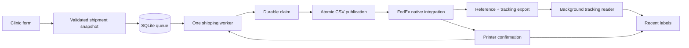

# How it works

The desktop form separates preparing a shipment from submitting it. Changing the selected clinic or editing a contact cannot modify a previously queued request.

## A small UI over a durable queue

The Tkinter form offers clinic search, address previews, contact validation, shipment type, and quantity. Each click creates immutable request payloads with unique references. SQLite stores their lifecycle outside the application source directory.

One worker processes requests in order. A shared lock coordinates additions with completion and error handling, preventing an accepted request from being stranded as the worker exits. Users can prepare another clinic while printing continues.

## Why submission is conservative

The worker marks a request uncertain **before** publishing its file. It then atomically renames a completely written CSV into the watched inbox. A crash after publication cannot cause that request to be submitted again automatically.

Completion requires both a processed request file and exactly one expected one-page Windows PrintService event. Extra print events, missing confirmation, or integration failure stop the run. Unsubmitted requests are cancelled; the existing uncertain shipment must be reconciled. This is a local duplicate guard, not a distributed exactly-once guarantee.

## Printing and tracking have different priorities

FedEx's native profile exports the request reference and tracking number after shipment completion. The Python tracking collector reads that local file on a separate thread. It never waits inside the shipping worker and never submits a replacement shipment.

Matching uses the complete request reference, not clinic name or timing. Partial writes are ignored until complete; conflicting numbers are flagged. Tracking lives in a separate cache so collection does not write to the shipment queue. Native export overhead has not been independently benchmarked.

## Starting and stopping

The production adapter launches Ship Manager once if needed. Booting and open dialogs return a waiting state; requests remain unpublished until the operator clears prompts. A later readiness poll cannot restart a closed client. The app does not dismiss arbitrary dialogs.

Closing during a run finishes observing the submitted request, then cancels remaining unpublished work. Reopening never silently resumes a previous queue. Search and preparation can continue during a run, but unresolved shipments from a previous run block new submission.

## Native integration boundary

PowerShell discovers the installed desktop application and connects its integration profile through Windows accessibility controls. The native folder watcher creates the label. The application still depends on that desktop client; a service-only alternative has not been verified.

The adapter reflects a specific Ship Manager version, printer, and port. The example XML documents the field mappings but cannot be deployed as-is. Deployment requires local validation; it is not an installer for arbitrary shipping workstations.

## Demo boundary

The demo runs the same form, queue, serial worker, and tracking reader against `SimulatedFedEx`. It uses a fresh temporary directory and fictional clinic records. The simulator moves demo files to Processed and produces fake print observations and tracking records. It does not start FedEx, invoke PowerShell, contact a network, or print.

An end-to-end test forbids subprocess calls while queuing multiple clinics and checking their simulated results. Other tests cover duplicate clicks, appending during publication, startup waits, ambiguous printer events, crash recovery, payload snapshots, malformed tracking exports, and copy interactions.
